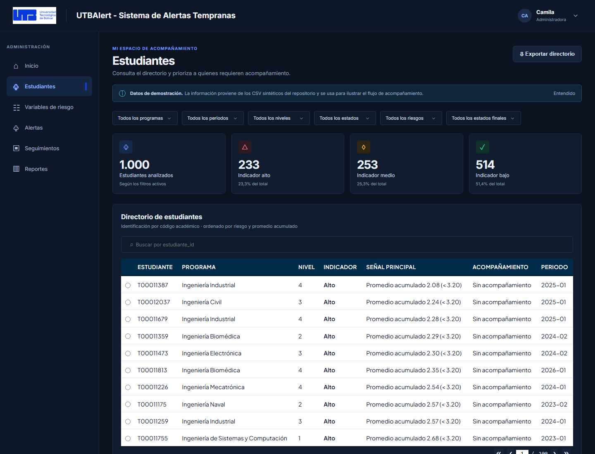
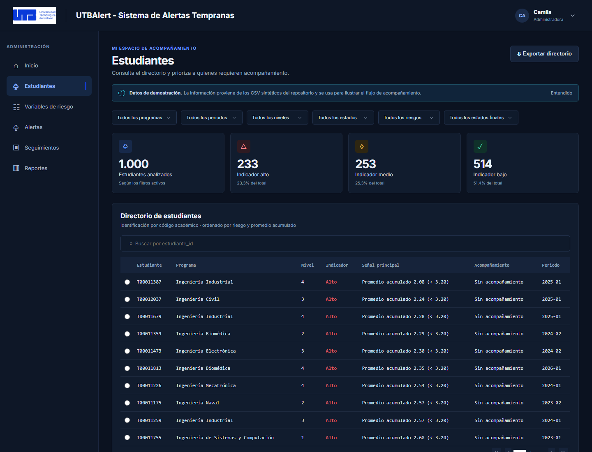
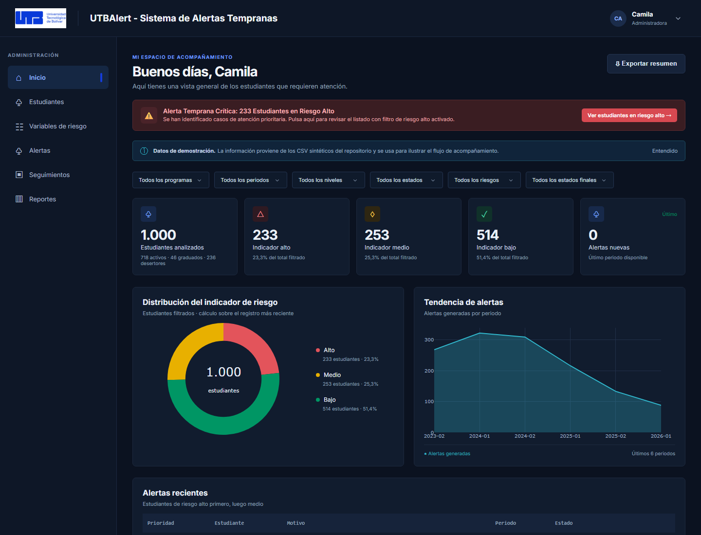
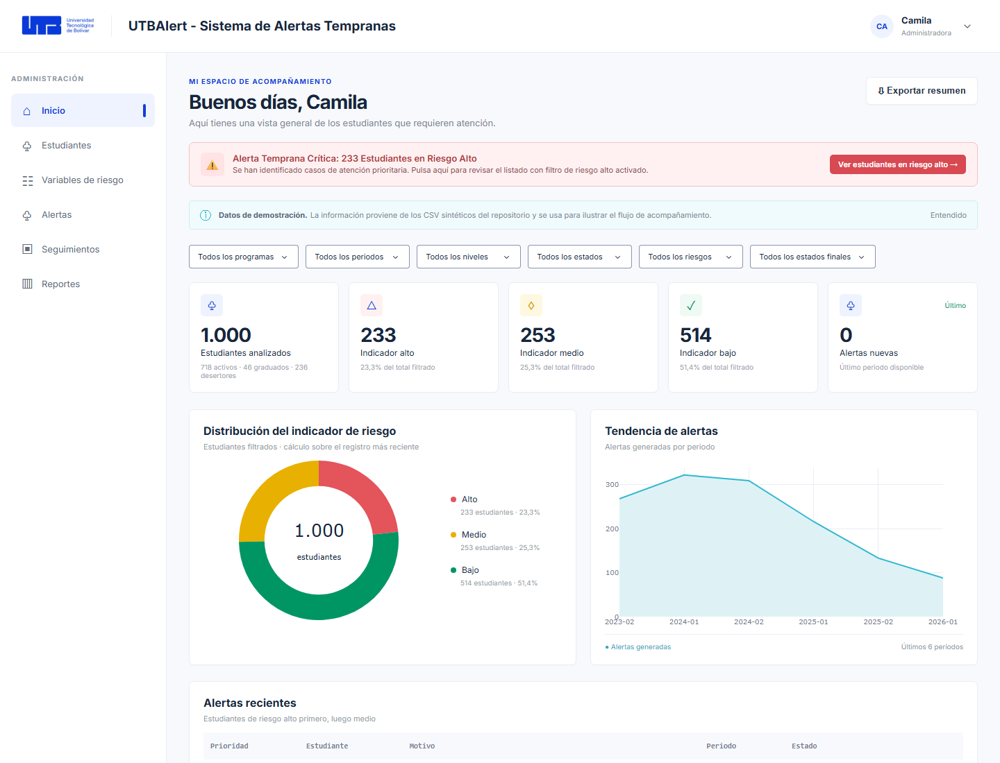

# Restaurar el diseño original conservando las funcionalidades añadidas

**Proyecto:** IS_UTBAlert · Dashboard de Alertas Tempranas
**Repositorio:** <https://github.com/Zulianys-024/IS_UTBAlert>
**Fecha:** 3 de noviembre de 2026
**Rama con la corrección aplicada:** `fix/restaurar-diseno-visual` (commit `a0e0b71`)

---

## 1. Resumen ejecutivo

El diseño no se "perdió": se rompió por **un solo archivo nuevo**, `assets/custom.css`
(279 líneas), que se añadió junto con la funcionalidad del banner de alerta crítica
(RF-05). Ese archivo redefine tipografía, tarjetas, tablas, modales y formularios con
`!important`, y como los colores del modo oscuro de las tablas se generan **inline**
desde `app.py`, el `!important` de la hoja externa gana y deja las tablas en blanco.

El resto de los cambios de los compañeros son funcionalidad legítima y se conserva:

| Archivo | Cambio de los compañeros | ¿Afecta el diseño? |
|---|---|---|
| `assets/custom.css` | **+279 líneas nuevas** | **Sí — es la causa raíz** |
| `app.py` | +74 líneas: banner RF-05, logos, título, márgenes de la gráfica de tendencia, `debug=True` | Parcial |
| `utbapp/i18n.py` | +16 líneas: textos del banner y del login | No (solo textos) |
| `run.py` | `debug=True` | Sí (barra de desarrollo visible) |
| `assets/logo*.png`, `Documentación/logo*.png` | logos institucionales nuevos | Sí (rebrand intencional) |

La corrección ya está aplicada y verificada en la rama `fix/restaurar-diseno-visual`.

---

## 2. Causa raíz del modo oscuro inconsistente

### Por qué ocurre

1. `assets/style.css` define el tema oscuro con selectores `.theme-dark ...`.
2. `app.py` → `table_styles(dark)` devuelve los colores de la tabla como **estilos inline**
   (`backgroundColor`, `color`, etc.) que se aplican al `DataTable`.
3. `assets/custom.css` añade reglas con `!important` sobre los mismos elementos:

```css
/* assets/custom.css — versión de los compañeros, líneas 181-205 */
.dash-table-container .dash-spreadsheet-container .dash-spreadsheet-inner th {
  background-color: var(--utb-primary) !important;   /* #002B49 azul marino */
  color: #FFFFFF !important;
  font-family: var(--font-main) !important;          /* Plus Jakarta Sans */
  font-size: 0.82rem !important;
  text-transform: uppercase !important;
  ...
}
.dash-table-container .dash-spreadsheet-container .dash-spreadsheet-inner td {
  background-color: #FFFFFF !important;              /* blanco fijo */
  color: var(--text-primary) !important;             /* texto oscuro fijo */
  font-family: var(--font-main) !important;
  font-size: 0.88rem !important;
  ...
}
```

Un `!important` de una hoja de estilos **siempre** gana sobre un estilo inline que no lo
sea. Por eso el modo oscuro "funcionaba" en el resto de la interfaz (tarjetas, KPIs,
gráficas) pero **no en las tablas**.

### Evidencia medida en el navegador

Ventana de 1000 px, tema oscuro activo (`#app.theme-dark`), página `/estudiantes`:

| Propiedad | Antes (con `custom.css`) | Después (corregido) |
|---|---|---|
| Fondo de cabecera (`th`) | `rgb(0, 43, 73)` azul marino | `rgb(22, 35, 58)` gris azulado del tema |
| Color de texto de `th` | `rgb(255, 255, 255)` | `rgb(143, 160, 184)` |
| `text-transform` de `th` | `uppercase` | `none` |
| Tamaño de fuente `th` | `13.12 px` | `11 px` |
| Fondo de celda (`td`) | `rgb(255, 255, 255)` blanco | `rgb(17, 28, 46)` del tema |
| Color de texto `td` | `rgb(15, 23, 42)` | `rgb(214, 224, 239)` |
| Fuente de la tabla | Plus Jakarta Sans | la del diseño original |
| Ancho de la tabla | `1067 px` | `929 px` |

Además, `custom.css` importaba Google Fonts y redefinía `body { font-family }`, por lo
que la tabla usaba una tipografía distinta al resto de la aplicación (el `body` real
seguía en `Inter` porque `style.css` se carga después).

### Comparación visual

| Antes | Después |
|---|---|
|  |  |

---

## 3. Causa raíz del ancho que "se desfasa"

La misma hoja explica el problema de la última captura:

1. `custom.css` subía las celdas a `0.88rem` y ponía `text-transform: uppercase` en las
   cabeceras → la tabla pasaba de **929 px a 1067 px**.
2. `.dash-table-container` no tenía `overflow-x`, así que la tabla **empujaba el ancho del
   documento** en lugar de hacer scroll dentro de la tarjeta.
3. Resultado medido a 1000 px de ventana: `document.scrollWidth = 1308 px` (308 px de
   desborde). La barra lateral se quedaba fija y el contenido se desalineaba.

### Corrección aplicada

```css
/* assets/style.css */
.table-card { min-width: 0; }
.dash-table-container { overflow-x: auto; }
```

Resultado medido tras el cambio: `document.scrollWidth = 985 px` (sin desborde) y la
tabla hace scroll **dentro** de la tarjeta (`clientWidth 703 px`, `scrollWidth 929 px`).

> **Nota:** por debajo de ~900 px de ancho la barra lateral fija (200-240 px) sigue sin
> colapsar. Eso ya era así en el diseño original y no es lo que se ve en las capturas.
> Si se quiere soporte real de móvil, hay que añadir un breakpoint que convierta la barra
> lateral en un menú superior; es un cambio aparte.

---

## 4. Otros dos defectos visibles que se corrigieron

### 4.1 Tarjeta roja de error de Dash

```python
# app.py
dcc.Input(id="followup-date", type="date", ...)
```

Dash 4.5 **no admite** `type="date"` en `dcc.Input`. Al abrir `/alertas`,
`/seguimientos`, `/reportes` o `/perfil` aparecía una tarjeta roja:

> Invalid argument `type` passed into Input with ID "followup-date".
> Expected one of ["text","number","password","email","range","search","tel","url","hidden"].
> Value provided: "date"

Corregido a:

```python
dcc.Input(id="followup-date", type="text", placeholder="AAAA-MM-DD", className="search-input")
```

Si se quiere un selector de calendario real, la alternativa es `dcc.DatePickerSingle`,
pero cambia el formato del valor y el callback que guarda el seguimiento.

### 4.2 Barra de desarrollo de Dash

`run.py` y el bloque `__main__` de `app.py` estaban en `debug=True`. Eso muestra la
barra flotante **"Plotly Cloud / Errors / Callbacks / Server"** encima de la interfaz.
Se restauró `debug=False`.

---

## 5. Qué se conservó de los compañeros

- ✅ Banner de alerta temprana crítica (RF-05) y su callback
  `on_critical_alert_click` (filtra por riesgo alto y navega a `/estudiantes`).
- ✅ Estilos del banner, ahora con **variante de modo oscuro** y versión responsive.
- ✅ Logos institucionales nuevos y textos de marca ("UTBAlert - Sistema de Alertas
  Tempranas").
- ✅ Márgenes/altura de la gráfica de tendencia.
- ✅ Toda la lógica, los datos y los tests.

`assets/custom.css` quedó reducido de **279 a 96 líneas** y solo contiene el banner.
Todo lo demás (tarjetas, KPIs, tablas, modales, `Select-*`, `login-card`) era **código
muerto**: ninguna de esas clases se usa en `app.py`.

---

## 6. Verificación

- `pytest`: **6 passed**.
- Navegador, 1000 px, tema oscuro: sin desborde de página, tabla con scroll interno,
  colores del tema, sin tarjetas de error, sin barra de desarrollo.
- Navegador, 1440 px: modo claro y oscuro consistentes en Inicio y Estudiantes.

| Oscuro · Inicio (banner RF-05) | Claro · Inicio |
|---|---|
|  |  |

---

## 7. Si además se quiere revertir el rebrand

Los logos y el texto "UTBAlert - Sistema de Alertas Tempranas" fueron un cambio
deliberado (`a66ec56 style: actualizar logos institucionales, textos de marca...`).
Si el equipo decide volver al logo tipográfico original:

```bash
git revert --no-commit a66ec56   # revierte logos, textos y márgenes de la gráfica
git checkout fix/restaurar-diseno-visual -- assets/style.css   # conserva el fix de tablas
```

O de forma selectiva, restaurando solo el bloque `brand` y `login-logo` de `header()` y
`login_page()` desde el commit `6e41684`.

---

## 8. Cómo aplicar la corrección

```bash
git checkout main
git merge fix/restaurar-diseno-visual
git push origin main
```

O, si se prefiere revisión previa, abrir un Pull Request desde
`fix/restaurar-diseno-visual` hacia `main`.

---

## 9. Por qué NO conviene entregar un `.zip` + prompt

| Opción | Problema |
|---|---|
| **ZIP de la carpeta + prompt** | Se pierde el historial; el compañero tiene que adivinar qué cambió; el siguiente merge vuelve a pisar el diseño; no hay revisión ni reversión. |
| **Rama + Pull Request (recomendado)** | El diff son 4 archivos y ~78 líneas; se revisa en 2 minutos; queda registrado quién cambió qué y por qué; se puede revertir con un comando. |
| **Revertir el commit de estilos** | Válido, pero borra también el banner. Mejor el enfoque selectivo de esta rama. |

**Recomendación:** merge de `fix/restaurar-diseno-visual` en `main` (o PR). El `.zip` solo
tiene sentido si el compañero ya no tiene acceso al repositorio.
